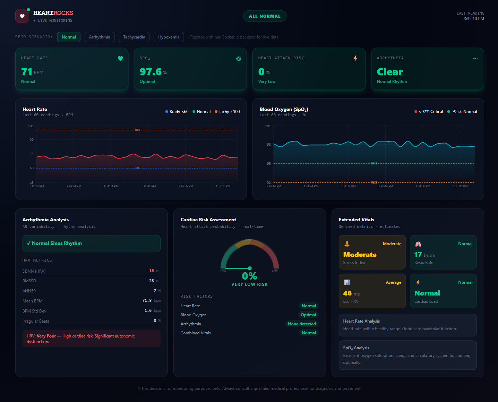
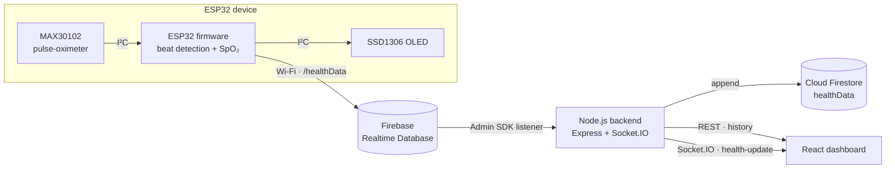
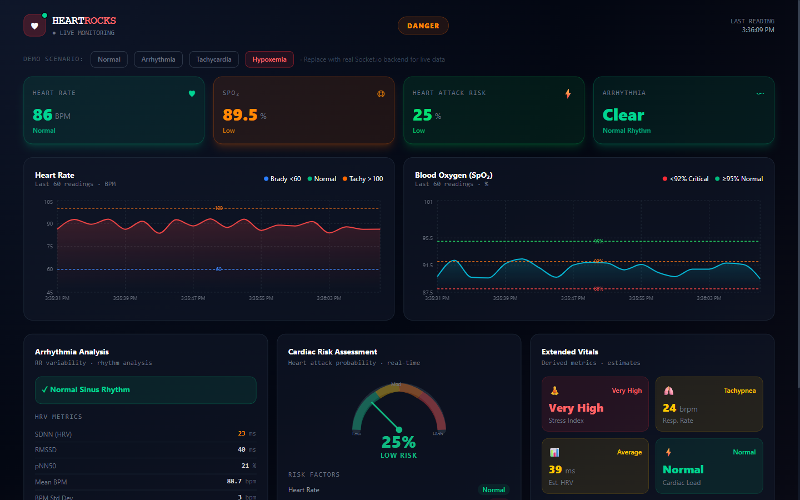

# HEARTROCKS

**Real-time IoT pulse-oximeter and cardiac-monitoring system.** An ESP32 with a MAX30102 fingertip sensor streams heart rate and SpO₂ through Firebase to a Node.js backend and a live React dashboard.


> Built in 24 hours at the **Zyro hackathon finals** for the **Smart Health** theme (May 2026).


<sub>The dashboard in demo mode ("Normal" scenario). With the device connected, the same view updates live from the sensor.</sub>

## Contents

- [Overview](#overview)
- [Architecture](#architecture)
- [Hardware](#hardware)
- [How it works](#how-it-works)
- [Tech stack](#tech-stack)
- [Repository structure](#repository-structure)
- [Getting started](#getting-started)
- [Run with Docker](#run-with-docker)
- [API and data model](#api-and-data-model)
- [Security](#security)
- [Known limitations and roadmap](#known-limitations-and-roadmap)
- [Author](#author)

## Overview

A fingertip pulse oximeter shows a number and keeps nothing. HEARTROCKS turns the same sensor into a connected monitor: every reading is stored, streamed live and analysed for warning signs.

- **On the device:** an ESP32 reads a MAX30102 optical sensor, detects heartbeats, estimates BPM and SpO₂, and shows both on an OLED display.
- **In the cloud:** each reading travels over Wi-Fi to Firebase Realtime Database. A Node.js service archives it in Cloud Firestore and pushes it to every open dashboard over Socket.IO.
- **On the dashboard:** live charts with clinical thresholds, heart-rate-variability metrics, rule-based arrhythmia screening, a cardiac-risk score and tiered alerts. A demo mode replays simulated patient scenarios when no device is connected.

## Architecture



1. The **ESP32** samples the MAX30102 over I²C, detects beats, computes BPM and SpO₂ (averaged over 5 beats) and draws them on the OLED.
2. After every valid beat it writes `{ bpm, spo2, timestamp }` to `/healthData` in **Firebase Realtime Database**, signed in with anonymous Firebase Auth.
3. The **backend** listens to `/healthData` with the Firebase Admin SDK, skips unchanged readings, tags each one with a status and appends it to the `healthData` collection in **Cloud Firestore**.
4. Each stored reading is broadcast to connected browsers as a Socket.IO `health-update` event.
5. The **dashboard** loads the latest 100 readings over REST, then updates live from the socket. All analytics run in the browser.

## Hardware

| Part | Purpose |
| --- | --- |
| ESP32 DevKit V1 (`esp32doit-devkit-v1`) | Microcontroller with Wi-Fi |
| MAX30102 pulse-oximetry module | Red and infrared PPG signal for heart rate and SpO₂ |
| SSD1306 OLED, 128 × 64, I²C (address `0x3C`) | On-device readout |

Both modules share the ESP32's default I²C bus, clocked at 400 kHz:

| Signal | ESP32 | MAX30102 | SSD1306 |
| --- | --- | --- | --- |
| Power | 3V3 | VIN | VCC |
| Ground | GND | GND | GND |
| Data | GPIO 21 (SDA) | SDA | SDA |
| Clock | GPIO 22 (SCL) | SCL | SCL |

## How it works

### Firmware (`firmware/src/main.cpp`)

| Step | Implementation |
| --- | --- |
| Sampling | MAX30102 in red + IR mode: 100 samples/s, 4-sample averaging, 411 µs pulse width, 4096 ADC range |
| Finger detection | Samples are processed only while the red channel reads above 10 000; otherwise the OLED shows **No Finger** |
| Beat detection | A beat is a local maximum of the red signal (the slope turns from rising to falling). BPM = 60 000 ÷ ms since the previous beat, kept only when 45 < BPM < 180 |
| SpO₂ | Ratio of ratios R = (AC<sub>red</sub> / DC<sub>red</sub>) ÷ (AC<sub>IR</sub> / DC<sub>IR</sub>), SpO₂ ≈ 110 − 25·R, clamped to 80–100 % (see [known limitations](#known-limitations-and-roadmap)) |
| Smoothing | Moving average of the last 5 beats for both values |
| Output | Serial log (115200 baud), OLED, and `updateNode("/healthData")` to Firebase over Wi-Fi |

### Backend (`backend/`)

- `syncRealtimeToFirestore.js` subscribes to `/healthData`, validates each value, skips duplicates and assigns a status: **Critical Oxygen** (SpO₂ < 90 %), **Abnormal Heart Rate** (BPM < 50 or > 120) or **Normal**. It then appends the reading to Firestore and emits `health-update`.
- `server.js` serves the REST API (Express 5 with Helmet, CORS and Morgan) and hosts the Socket.IO server.

### Dashboard (`frontend/`)

- Loads history over REST, then streams live readings over Socket.IO, keeping a rolling window of 120 readings.
- With no live data it starts **demo mode**: four simulated scenarios (Normal, Arrhythmia, Tachycardia, Hypoxemia), one reading every 2 s. Demo mode stops by itself as soon as real data arrives.
- Shows vital-sign cards, heart-rate and SpO₂ charts with clinical thresholds, an HRV and arrhythmia panel, a cardiac-risk gauge, extended vitals and alert toasts.

| Insight | Method (`frontend/src/utils/`) |
| --- | --- |
| SpO₂ zone | Optimal ≥ 97 %, Normal ≥ 95 %, Below normal ≥ 92 %, Low ≥ 88 %, Critical below 88 % |
| Heart-rate zone | Severe bradycardia < 40, Bradycardia < 60, Normal ≤ 100, Elevated ≤ 120, Tachycardia ≤ 150, Severe tachycardia above 150 BPM |
| Cardiac-risk score | 0–100 heuristic built from the zones, with an extra penalty when tachycardia coincides with SpO₂ < 95 % |
| HRV | SDNN, RMSSD and pNN50 over RR intervals derived from the last 30 readings |
| Arrhythmia screening | Rule-based patterns (AFib-like, PVC-like, irregular tachycardia or bradycardia) with a confidence score, once 15 or more readings exist |
| Extended vitals | Estimated HRV, stress index and respiratory rate |
| Alerts | Info, warning, critical and emergency toasts; emergencies also flash a red border around the screen |


<sub>Hypoxemia scenario: SpO₂ falls below 92 %, the status escalates to DANGER, and the risk, stress and respiratory estimates update.</sub>

## Tech stack

| Layer | Technologies |
| --- | --- |
| Hardware | ESP32 DevKit V1, MAX30102, SSD1306 OLED |
| Firmware | C++ (Arduino framework) on PlatformIO · espressif32 6.13 · Firebase ESP32 Client 4.4 · Adafruit SSD1306 + GFX · SparkFun MAX3010x |
| Cloud | Firebase Realtime Database · Cloud Firestore · Firebase Anonymous Auth |
| Backend | Node.js · Express 5 · Socket.IO 4 · Firebase Admin SDK 13 · Helmet · Morgan |
| Frontend | React 19 · Vite 8 · Tailwind CSS 4 · Recharts 3 · Socket.IO client |
| DevOps | Docker multi-stage builds · nginx · Docker Compose · Docker Hub |

## Repository structure

```text
HEARTROCKS/
├── firmware/                       ESP32 firmware (PlatformIO)
│   ├── platformio.ini              board, framework and library dependencies
│   ├── src/main.cpp                sampling, beat and SpO₂ estimation, OLED, Firebase upload
│   └── include/secrets.example.h   template for Wi-Fi and Firebase credentials
├── backend/                        Node.js service
│   ├── server.js                   REST API and Socket.IO server
│   ├── syncRealtimeToFirestore.js  RTDB → Firestore sync and live broadcast
│   ├── firebase.js                 Firebase Admin initialisation
│   ├── socket/socket.js            Socket.IO setup
│   ├── routes/, controllers/       MVC version of the health endpoints (not mounted by server.js)
│   └── Dockerfile
├── frontend/                       React dashboard
│   ├── src/App.jsx                 data layer: REST history, Socket.IO stream, demo mode
│   ├── src/components/             cards, charts, panels and alerts
│   ├── src/utils/                  healthAnalysis.js, arrhythmiaDetection.js
│   └── Dockerfile
├── docs/images/                    screenshots
└── compose.yaml                    backend and dashboard in one command
```

## Getting started

**Prerequisites:** [PlatformIO](https://platformio.org/) (VS Code extension or CLI), Node.js 22.13 or newer (20.19+ also works), and a Firebase project. Docker Desktop is optional.

### 1. Firebase

1. Create a Firebase project and enable **Realtime Database**, **Cloud Firestore** and **Authentication → Anonymous**.
2. Copy the project's **Web API key** (Project settings → General). The firmware uses it.
3. Generate a service-account key (Project settings → Service accounts → *Generate new private key*) and save it as `backend/serviceAccountKey.json`. Git ignores this file.
4. If you use your own project instead of `heartrock-5baf0`, update `DATABASE_URL` in `firmware/src/main.cpp` and `databaseURL` in `backend/firebase.js`.

### 2. Firmware

```bash
cd firmware
cp include/secrets.example.h include/secrets.h   # add your Wi-Fi name, password and Web API key
pio run -t upload                                 # build and flash the ESP32
pio device monitor -b 115200                      # matches Serial.begin(115200) in the firmware
```

The serial log should show `WiFi Connected`, `Firebase Ready`, then `BPM` / `SpO2` lines with `Firebase Upload OK`. If it keeps printing dots, the Wi-Fi details in `secrets.h` are wrong: the firmware waits for Wi-Fi before it starts the sensor and display.

### 3. Backend

```bash
cd backend
npm ci
npm start            # http://localhost:5000
```

### 4. Dashboard

```bash
cd frontend
npm ci
npm run dev          # http://localhost:5173
```

The dashboard expects the backend at `http://localhost:5000`; set the `VITE_BACKEND_URL` environment variable to point it elsewhere. Without a backend it runs in demo mode.

## Run with Docker

Run the backend and dashboard together (this needs `backend/serviceAccountKey.json`):

```bash
docker compose up --build
```

| Service | URL | Image |
| --- | --- | --- |
| Dashboard (nginx) | http://localhost:8080 | [`adplayer/heartrocks-frontend`](https://hub.docker.com/r/adplayer/heartrocks-frontend) |
| Backend API | http://localhost:5000 | [`adplayer/heartrocks-backend`](https://hub.docker.com/r/adplayer/heartrocks-backend) |

Or run the published images directly:

```bash
# Dashboard only: no Firebase needed, starts in demo mode
docker run --rm -p 8080:80 adplayer/heartrocks-frontend

# Backend, with your Firebase Admin key mounted read-only
docker run --rm -p 5000:5000 \
  -v "$PWD/backend/serviceAccountKey.json:/app/serviceAccountKey.json:ro" \
  adplayer/heartrocks-backend
```

The images contain no credentials: the backend key is mounted at runtime, and Compose publishes ports on `127.0.0.1` only. The dashboard's backend URL is fixed when the image is built; change it with `--build-arg VITE_BACKEND_URL=…`.

## API and data model

| Method | Endpoint | Description |
| --- | --- | --- |
| `GET` | `/` | Liveness check: returns `Pulse Oximeter Backend Running` |
| `POST` | `/api/health` | Ingest `{ deviceId?, bpm, spo2 }`; the reading is stored in Firestore and broadcast (an HTTP alternative to the RTDB path) |
| `GET` | `/api/health/latest` | Most recent reading |
| `GET` | `/api/health/history` | Latest 100 readings, newest first |

**Socket.IO:** event `health-update` with payload `{ id, deviceId, bpm, spo2, status, timestamp }`.

| Store | Path | Shape |
| --- | --- | --- |
| Realtime Database (written by the ESP32) | `/healthData` | `{ bpm, spo2, timestamp }`, where `timestamp` is ms since device boot |
| Cloud Firestore (written by the backend) | `healthData/{id}` | `{ deviceId, bpm, spo2, status, timestamp }`, where `timestamp` is Unix time in ms |

## Security

- The device's Wi-Fi and Firebase credentials live in `firmware/include/secrets.h`, which Git ignores. `secrets.example.h` is the template.
- The Firebase Admin key (`backend/serviceAccountKey.json`) is gitignored, excluded from the Docker build context and mounted read-only at runtime.
- The Firebase web config in `frontend/src/firebase.jsx` is a public client identifier, not a secret. Firebase Security Rules decide who can read and write, for example:

```json
{
  "rules": {
    "healthData": {
      ".read": "auth != null",
      ".write": "auth != null"
    }
  }
}
```

## Known limitations and roadmap

HEARTROCKS is a 24-hour hackathon prototype for demonstration. It is **not a medical device**.

- **SpO₂ stays at its 98 % default.** The SpO₂ statistics are reset after every beat (`firmware/src/main.cpp`, line 384), so the ratio-of-ratios branch, which needs more than 10 samples (line 246), never runs. The fix is to accumulate the red and IR minimum, maximum and mean on every sample and reset them only after R is computed.
- **Beat detection runs on the raw red signal.** Without a band-pass filter, motion and ambient light add false peaks; a filtered or derivative-based detector would be more robust.
- **HRV and arrhythmia analysis use RR intervals derived from BPM readings,** not true beat-to-beat timing, and the risk, stress and respiratory figures are heuristics. Treat them as a screening demo only.
- **Roadmap:** per-device IDs and authentication on the API, a hosted deployment, and push or SMS notifications for emergency alerts.

## Author

**Aayush Dey** · [@deyaayush2006-coder](https://github.com/deyaayush2006-coder)
